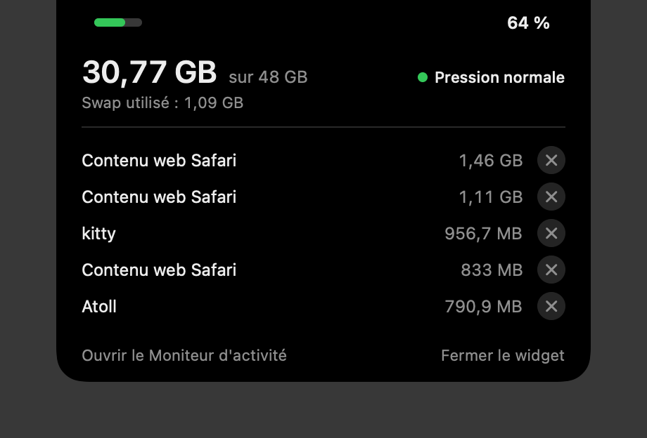

# NotchRAM

Une petite jauge de RAM logée dans l'encoche du MacBook. Au survol, elle se déplie : mémoire utilisée
et totale, pression mémoire, swap, et les cinq processus les plus gourmands, chacun avec un bouton pour
le quitter.

[English](README.md)

<p align="center"></p>

## Ce qu'il fait

- Au repos : une barre fine à gauche de l'encoche, le pourcentage à droite. La barre passe à
  l'orange ou au rouge quand macOS signale une pression mémoire élevée ou critique.
- Au survol : la mémoire utilisée (comptée comme dans le Moniteur d'activité : app + câblée +
  compressée), le niveau de pression, le swap et les cinq processus les plus gourmands.
- Quitter un processus demande deux clics en moins de 3 secondes : un clic égaré ne ferme rien.
  Les apps reçoivent une demande normale de fermeture (elles peuvent proposer d'enregistrer), les
  autres processus un `SIGTERM`.
- Sans encoche (écran externe, capot fermé, Mac Intel), il se replie en pastille sous la barre des menus.

C'est un seul fichier Swift, sans dépendance. Il ne fait aucune requête réseau et n'écrit rien sur le disque.

## Installation

NotchRAM demande macOS 14 ou plus récent. Il tourne sur les Mac Apple Silicon et Intel.

### Télécharger

1. Télécharge `NotchRAM-x.y.z.zip` depuis la [dernière version](https://github.com/lepalph/notch-ram/releases/latest) et décompresse-le.
2. Range `NotchRAM.app` dans le dossier Applications.
3. L'app n'est pas notarisée par Apple : macOS la bloque au premier lancement. Débloque-la une fois,
   au choix :
   - dans le Terminal : `xattr -dr com.apple.quarantine /Applications/NotchRAM.app`
   - ou ouvre-la, clique sur Terminé dans l'alerte, puis va dans Réglages Système → Confidentialité et
     sécurité et clique sur « Ouvrir quand même » à côté du message sur NotchRAM.
4. Ouvre NotchRAM : la jauge apparaît autour de l'encoche.

Le fichier `.sha256` à côté de chaque zip sert à vérifier le téléchargement : `shasum -a 256 NotchRAM-*.zip`.

### Compiler soi-même

Il faut les Command Line Tools de Xcode (`xcode-select --install`).

```sh
git clone https://github.com/lepalph/notch-ram.git
cd notch-ram
./build.sh                       # compile une app universelle, lance un autotest, la copie dans ~/Applications
open ~/Applications/NotchRAM.app
```

Une app compilée sur ton propre Mac n'est jamais bloquée : l'étape 3 ci-dessus est inutile.

### Lancement à l'ouverture de session

Pour le lancer à l'ouverture de session : Réglages Système → Général → Ouverture.
Pour l'arrêter : « Fermer le widget » dans le panneau, ou `pkill NotchRAM`.

## Limites

- L'interface est en français.
- La liste ne montre que les processus lisibles par ton utilisateur : ceux du système, comme
  `WindowServer` ou `kernel_task`, n'y sont pas.
- Le survol est détecté en interrogeant la souris toutes les 50 ms, les chiffres se mettent à jour
  toutes les 2 secondes.

## Options en ligne de commande

| Option | Effet |
|---|---|
| `--selftest` | Affiche les mesures, les vérifie et quitte (code d'erreur en cas d'échec). |
| `--open` | Démarre avec le panneau déplié, pour les captures. |
| `--capture fichier.png` | Rend le panneau déplié en image, sans passer par l'écran. |

## Licence

MIT
