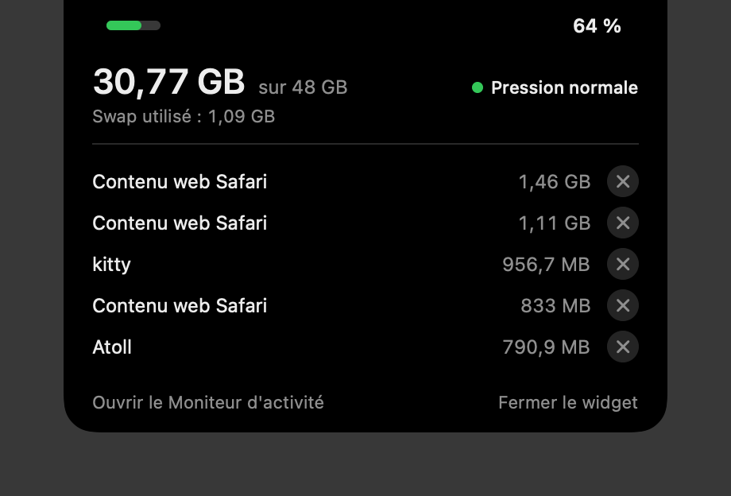

# NotchRAM

A tiny RAM gauge that lives in your MacBook's notch. Hover it and it unfolds: used and total memory,
memory pressure, swap, and the five processes using the most RAM, each with a quit button.

[Français](README.fr.md)

<p align="center"></p>

## What it does

- At rest: a thin bar on the left of the notch and the percentage on the right. The bar turns
  orange or red when macOS reports high or critical memory pressure.
- On hover: used memory (counted the way Activity Monitor counts it: app + wired + compressed),
  pressure level, swap in use, and the top five processes.
- Quitting a process takes two clicks within 3 seconds, so a stray click closes nothing. Apps are
  asked to quit normally (they can still offer to save your work); other processes get `SIGTERM`.
- No notch (external display, lid closed, Intel Mac): it falls back to a small pill under the menu bar.

It is a single Swift file with no dependencies. It makes no network requests and stores nothing on disk.

## Install

NotchRAM needs macOS 14 or later. It runs on Apple Silicon and Intel Macs.

### Download

1. Download `NotchRAM-x.y.z.zip` from the [latest release](https://github.com/lepalph/notch-ram/releases/latest) and unzip it.
2. Move `NotchRAM.app` to your Applications folder.
3. The app isn't notarized by Apple, so macOS blocks it the first time. Unblock it once, either way:
   - in Terminal: `xattr -dr com.apple.quarantine /Applications/NotchRAM.app`
   - or open it, click Done on the warning, then go to System Settings → Privacy & Security and
     click "Open Anyway" next to the NotchRAM message.
4. Open NotchRAM. The gauge appears around the notch.

The `.sha256` file next to each zip lets you check the download: `shasum -a 256 NotchRAM-*.zip`.

### Build from source

You need the Xcode Command Line Tools (`xcode-select --install`).

```sh
git clone https://github.com/lepalph/notch-ram.git
cd notch-ram
./build.sh                       # builds a universal app, runs a self-test, copies it to ~/Applications
open ~/Applications/NotchRAM.app
```

A build made on your own Mac is never blocked, so step 3 above isn't needed.

### Start at login

To start it at login, add `NotchRAM` in System Settings → General → Login Items.
To stop it, click "Fermer le widget" in the panel, or run `pkill NotchRAM`.

## Limits

- The interface is in French.
- The process list only shows processes your user can read, so system ones such as `WindowServer`
  or `kernel_task` don't appear.
- Hover is detected by polling the mouse every 50 ms, and figures refresh every 2 seconds.

## Command-line flags

| Flag | Effect |
|---|---|
| `--selftest` | Prints the current readings, checks them, and exits (non-zero on failure). |
| `--open` | Starts with the panel unfolded, for screenshots. |
| `--capture file.png` | Renders the unfolded panel to an image without touching the screen. |

## License

MIT
